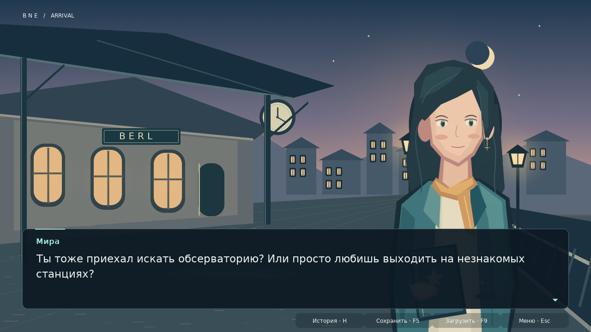

# Berl Novella Engine · BNE

Небольшой движок на **Python + pygame-ce** со своим языком **`.bne`**, вдохновлённым Ren’Py.
Автор пишет историю в обычных текстовых файлах, а движок отвечает за окно, диалоги,
выборы, изображения, звук и сохранения.

**Версия 0.1 — рабочая визуальная новелла.** RPG-ходьбы, тайлов и редактора карт пока нет.
`game/rpg.bne` оставлен как заготовка следующего этапа, а не как работающая RPG-карта.



## Запуск

Нужен **Python 3.10+**. Игра запускается как обычное настольное приложение
на компьютере с графическим окружением, не как веб-страница.

```bash
python -m venv .venv
```

Активировать окружение:

Linux / macOS:

```bash
source .venv/bin/activate
```

Windows PowerShell:

```powershell
.venv\Scripts\Activate.ps1
```

Установить зависимости и запустить из корня репозитория:

```bash
python -m pip install -e "."
python -m bne
```

Также работают `python main.py` и команда `bne` после установки.
Если PowerShell не разрешает активацию, можно запускать команды напрямую через
`.venv\Scripts\python.exe` вместо `python`.

```bash
python -m bne --check                  # проверить сценарии и наличие ресурсов без окна
python -m bne --mute                   # без звука
python -m bne --fullscreen             # полный экран
python -m bne path/to/game             # другая папка игры
python -m bne path/to/game/manager.bne  # или конкретный главный файл
python -m bne --save-dir path/to/saves  # например, если папка игры доступна только для чтения
```

## Архитектура игры

```text
game/
├── manager.bne             # настройки, персонажи, ресурсы, реестр сцен и старт
├── rpg.bne                 # заготовка будущих RPG-настроек; сейчас не исполняется
├── scene/
│   ├── scene1.bne          # прибытие на станцию
│   ├── scene2.bne          # площадь, условия и вызов поддиалога
│   └── scene3.bne          # разные варианты финала
├── images/
│   ├── backgrounds/        # фоны
│   └── characters/         # прозрачные PNG персонажей
├── audio/                  # музыка и звуковые эффекты
├── gui/                    # шрифт с кириллицей и его лицензия
└── saves/                  # JSON-сохранения; не попадают в Git
```

Имена файлов и сцен могут быть любыми: `scene1.bne` — соглашение демо, не ограничение.
**Все пути в `.bne` считаются относительно папки с `manager.bne`.**
Для переносимости используйте `/`, в том числе на Windows. Выход за пределы папки
игры, включая символьные ссылки наружу, запрещён.

### Главный файл — `manager.bne`

```renpy
# Объявления пишутся без отступов.
define config.title = "Моя новелла"
define config.font = "gui/DejaVuSans.ttf"

define m = Character("Мира", color="#9EE4D2")
default trust = 0

image bg station = "images/backgrounds/station.png"
image mira calm = "images/characters/mira_calm.png"

scene intro = "scene/scene1.bne"
scene ending = "scene/ending.bne"
start intro
```

`scene intro = "..."` **в менеджере** регистрирует файл сценария.
`scene bg station` **в сценарии** меняет фон. Это два разных контекста.

### Сценарий — `scene/scene1.bne`

```renpy
label start:
    scene bg station with fade
    show mira calm at right with dissolve
    play music "audio/evening.wav" loop fadein 1.0

    "Поезд ушёл. На станции остались только мы."
    m "Пойдёшь со мной?"

    menu:
        "Да, пойдём.":
            $ trust += 1
            m "Тогда я покажу тебе город."
        "Сначала осмотрюсь.":
            m "Хорошо. Я подожду."

    if trust > 0:
        m "Спасибо за доверие."

    jump ending
```

Для этого примера создайте также `scene/ending.bne`:

```renpy
label start:
    m "До скорой встречи."
    stop music fadeout 1.0
    return
```

В каждом зарегистрированном файле по умолчанию нужна `label start:`.
`jump ending` запускает другую сцену из менеджера; `jump имя_метки` — локальную метку.
Для явного обращения есть `jump ending.start`. Вложенные диалоги вызываются через
`call имя_метки` и заканчиваются `return`. На верхнем уровне `return` завершает историю.

Для добавления новой сцены достаточно создать `.bne`, зарегистрировать её в менеджере
и поставить `jump имя_сцены` в нужном месте истории.

## Что уже работает

- Диалоги с именем и цветом персонажа; рассказчик без имени.
- Постепенное появление текста и автоматическое разбиение длинных реплик на страницы.
- `scene`, `show`, `hide`; позиции `left`, `center`, `right`.
- Переходы `fade` и `dissolve`; изображения масштабируются под окно.
- `label`, `jump`, `call`, `return`, `end`; переходы между файлами сцен.
- `menu`, условные варианты выбора, вложенные `if / elif / else`.
- `default`, присваивания `$`, арифметика, сравнения, `and / or / not`.
- Подстановка `[variable]` в реплики, имена и варианты выбора.
- Музыка, звуковые эффекты, громкость и плавное включение/выключение звука.
- Главное меню, пауза, история реплик, быстрые сохранение и загрузка.
- Изменение размера окна с сохранением пропорций и полноэкранный режим.
- Проверка проекта до запуска и ошибки с именем файла и номером строки.

Это **собственный ограниченный DSL**, а не полная реализация Ren’Py.
Python-блоков, screen language, ATL, анимации спрайтов, отката истории и текстового ввода
в первой версии нет. Произвольный Python из `.bne` не выполняется.

Полный справочник: **[docs/SYNTAX.md](docs/SYNTAX.md)**.
Устройство движка и следующий RPG-этап: **[docs/ARCHITECTURE.md](docs/ARCHITECTURE.md)**.

## Управление

| Клавиша / действие | Назначение |
| --- | --- |
| ЛКМ, `Space`, `Enter` | Сначала показать реплику целиком, затем следующую страницу/реплику |
| `↑` / `↓`, `Enter`; `1`–`9`; ЛКМ | Выбор варианта в меню |
| Колесо мыши | Прокрутка длинного меню выбора или истории |
| Удерживать `Ctrl` | Быстро пропускать реплики; на выборе останавливается |
| `Esc` | Пауза / продолжить |
| `H` | Открыть / закрыть историю реплик |
| `F5` / `F9` | Быстро сохранить / загрузить |
| `F11` | Полноэкранный режим |
| `M` | Включить / выключить звук |

В главном меню и меню паузы доступны также `Tab`, `↑`, `↓` и `Enter`.
«Продолжить» в главном меню загружает быстрое сохранение.
Автосохранения пока нет: сохраняйтесь через `F5` или кнопку в интерфейсе.

### Сохранения

По умолчанию используется `game/saves/quick.json`. Сохраняются сцена, текущая реплика
или меню выбора, переменные, стек `call`, фон, спрайты, музыка и до 200 последних реплик.
Сохранение атомарное: неудачная запись не затирает предыдущий файл. Формат — JSON,
не `pickle`.

Загрузка возвращает к началу сохранённой реплики, меню или паузы. Текущая страница
и число уже напечатанных букв не сохраняются; таймер паузы и музыкальный трек
начинаются заново. При изменении `manager.bne` или подключённых сценариев старое
сохранение отклоняется с объяснением — это защищает от перехода на неверную команду.

## Разработка и проверки

```bash
python -m pip install -e ".[dev]"
python -m pytest
ruff check .
ruff format --check .
python -m bne --check
```

Тесты исполняют все 15 маршрутов демо, проверяют компилятор, безопасные выражения,
переходы, сохранения и интерфейс через SDL dummy-драйвер. Для запуска тестов
на безэкранном сервере не нужен X-сервер. CI настроен для Python 3.10, 3.12 и 3.13.

Иллюстрации и короткая синтезированная музыка демо созданы для этого проекта.
Их исходный генератор не требует дополнительных библиотек:

```bash
python tools/make_demo_assets.py
```

Код и демо-ресурсы — MIT. Шрифт DejaVu Sans распространяется на условиях
[своей лицензии](game/gui/LICENSE-DejaVu.txt).
